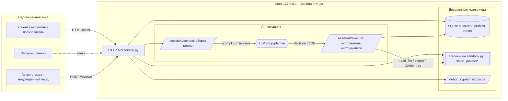

# Модель угроз. Практика 6 — Mini Shop

Ориентир — методология Microsoft Threat Modeling: (1) описание системы, (2) поиск угроз,
(3) меры защиты, (4) проверка. Классификация — STRIDE и OWASP Top-10 / OWASP LLM Top-10.

## 1. Описание системы и границы доверия

**Границы доверия, которые нарушает исходный код:**
- клиент ↔ сервер: сервер верит заголовкам клиента (`X-Role`) и параметрам (`id`, `user`, `path`, `price`);
- недоверенные отзывы ↔ prompt LLM: отзывы попадают в контекст модели без обезвреживания;
- решение LLM ↔ исполнитель: `/assistant/execute` исполняет инструменты без серверной проверки.

## 2. Угрозы по STRIDE

| STRIDE | Угроза | Где | Связь с отчётом |
|---|---|---|---|
| **S** Spoofing | Подделка роли через `X-Role`; кража токена из `/debug/logs` | `/admin/export`, `/debug/logs` | V6, V8 |
| **T** Tampering | Подмена цены; SQL-инъекция меняет/читает данные; `delete_tree` рушит файлы | `/orders`, `/profile`, `/execute` | V5, V1–V3, V11 |
| **R** Repudiation | Журнал открыт и недостоверен (содержит секреты, доступен всем) | `/debug/logs` | V8 |
| **I** Info Disclosure | Утечка чужих ПДн/чеков/секрета оператора; утечка исключений | `/profile`,`/orders`,`/files`,500 | V1,V4,V7,V11,V12 |
| **D** DoS / Destruction | Удаление всего дерева файлов стенда через помощника | `/assistant/execute` | V11 |
| **E** Elevation | Аноним → staff; клиент → доступ к чужим данным и инструментам | `/admin/export`,`/execute` | V6, V4, V11 |

## 3. Угрозы LLM-тракта (OWASP LLM Top-10)

- **LLM01 Prompt Injection:** отзывы (недоверенный ввод) подставляются в prompt → могут
  переопределить инструкции модели (V10).
- **LLM06 Excessive Agency:** модели предложены разрушительные инструменты (`delete_tree`,
  `export_profiles`), а исполнитель применяет решение без серверной авторизации (V11).
- **Вывод:** защита не должна зависеть от послушания модели — решение LLM обязан проверять сервер.

## 4. Меры защиты (план, применяется в Отчёте 2)

| Угроза | Мера |
|---|---|
| SQLi (V1–V3) | Параметризованные запросы, приведение типов, 400 на мусор |
| Broken auth / IDOR (V4,V6,V7) | Владелец и роль — только из серверной сессии; выборки по `owner`; `X-Role` игнорировать |
| Price tampering (V5) | Цена только из каталога на сервере |
| Files (V7) | Каталог из сессии, белый список `path`, без `..`; `sandbox.py` не менять |
| Logs (V8) | Закрыть `/debug/logs` ролью; маскировать пароли/токены |
| XSS (V9) | Экранирование вывода, запись отзыва только аутентифицированным |
| Prompt injection (V10) | Контекст по своей сессии/заказу; отзывы как недоверенные данные |
| Executor (V11) | Сессия + авторизация каждого инструмента, валидация аргументов, ограничение/запрет опасных |
| Error leak (V12) | Обобщённые ошибки клиенту, детали в журнал; валидация полей |

## 5. Проверка

Для каждой угрозы есть воспроизводимое доказательство в `evidence/before/` (Отчёт 1). После
исправлений те же сценарии повторяются в `evidence/after/` (Отчёт 2), добавляются регрессионные
тесты, падающие до фикса и зелёные после; штатные тесты `make step6` / `make test` остаются зелёными.
Для проверки prompt injection на реальной модели используется `shop-planner` из `opencode.json`:
сравнивается решение модели и действие исполнителя до и после фикса, плюс принудительная передача
опасного решения в `/assistant/execute` для проверки серверной защиты независимо от модели.
